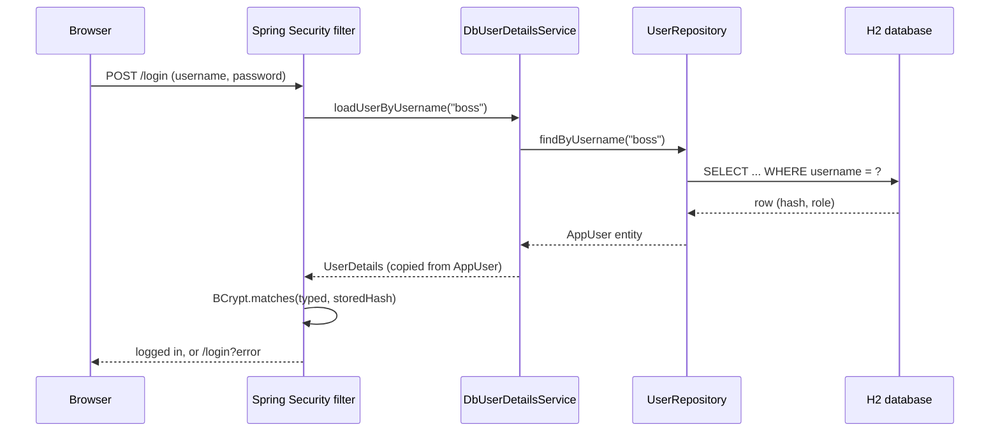

# Spring Security, from first endpoint to secured microservices

A hands-on learning project where I build up Spring Security **one concept at a time**: from a single endpoint, to database-backed BCrypt login, and on to JWT, Redis, Angular, OAuth2, Keycloak, Kafka and microservices.

Each finished lesson is a **git tag** (`lesson-05`, `lesson-06`, …), so you can open any tag and see exactly what the code looked like at that stage.


---

## What the app does today (after Lesson 7)

| URL | Who can open it |
|---|---|
| `/hello` | everyone, no login |
| `/secret` | any logged-in user |
| `/admin` | only users with role `ADMIN` |
| `/admin/users` | only `ADMIN`; lists users **without** password hashes (DTO) |

- Users live in a database (JPA + H2) and are loaded at login by a custom `UserDetailsService`.
- Passwords are stored only as **BCrypt hashes** (salted, cost 10), never as plain text.
- URL rules are defined in my own `SecurityFilterChain`, with role-based access.

### Login flow



---

## Concepts I've learned and applied

| Lesson | Topic | Key ideas |
|---|---|---|
| 1 | First endpoint | `@RestController`, `@GetMapping`, how a request reaches a method |
| 2 | Adding Spring Security | auto-configuration: default login page, generated user, everything locked |
| 3 | Configured user | `application.properties`, how my settings override Boot's defaults |
| 4 | Custom rules | `SecurityFilterChain` bean, `permitAll` vs `authenticated`, rule order (first match wins) |
| 5 | Roles | `hasRole("ADMIN")`, 401 vs 403, `UserDetailsService`, roles are case-sensitive |
| 6 | Password hashing | `PasswordEncoder` + BCrypt: salt, cost factor, one-way hashing, how `matches()` verifies a login, why unsalted hashes can be cracked by lookup |
| 7 | Database users | `@Entity`, `JpaRepository`, derived queries (`findByUsername`), custom `UserDetailsService`, **DTOs so hashes never leave the server** |

### Security lessons I learned by finding the bugs myself
- **A wrong rule doesn't crash anything.** `hasRole("admin")` vs `ADMIN` quietly locked out the real admin, which is why I test with real logins and not just "does it compile".
- **Swapped hashes = swapped passwords.** A hash belongs to the password it was made from, not to the user.
- **Never return entities from a controller.** My `/admin/users` endpoint first leaked every user's BCrypt hash. Leaked hashes allow offline guessing, so I fixed it with a `UserView` DTO.
- **Plain-text secrets hide in comments too.** Cleaning code means checking comments and git history, not only the code itself.

---

## Hands-on tools

**BCrypt lab** (`lesson01-hello/lab.sh`): experiments I used to understand hashing:

```bash
./lab.sh hash   admin123                 # same password, different hash every time (salt)
./lab.sh check  admin123 '<hash>'        # what Spring does at login
./lab.sh parts  '<hash>'                 # version | cost | salt | result
./lab.sh rehash admin123 '<hash>'        # re-blend with the stored salt, giving an identical hash
./lab.sh cost   admin123                 # each +1 on the cost doubles the time
```

---

## Roadmap (21 lessons)

**Part 1: Fundamentals**
- [x] 1. First endpoint
- [x] 2. Spring Security auto-configuration
- [x] 3. Configured user
- [x] 4. Custom `SecurityFilterChain`
- [x] 5. Roles (USER / ADMIN)
- [x] 6. BCrypt password hashing
- [x] 7. Users in a database (JPA + H2) + DTOs
- [ ] 8. Sign-up (registering new users)
- [ ] 9. CSRF and CORS

**Part 2: Docker and tokens**
- [ ] 10. Docker + docker compose (Postgres, Redis)
- [ ] 11. JWT access tokens
- [ ] 12. Refresh tokens in Redis (rotation, logout, revocation)
- [ ] 13. Angular front end (login, HTTP interceptor, auto-refresh)
- [ ] 14. Method security (`@PreAuthorize`)

**Part 3: Microservices**
- [ ] 15. OAuth2 login (Google)
- [ ] 16. Own authorization server (Keycloak)
- [ ] 17. Microservices as OAuth2 resource servers
- [ ] 18. API gateway (Spring Cloud Gateway, token relay)
- [ ] 19. Service-to-service security (client credentials)
- [ ] 20. Kafka: securing events between services
- [ ] 21. Rate limiting with Redis + production hardening

---

## Run it locally

Requirements: **Java 25** and Maven.

```bash
cd lesson01-hello
mvn spring-boot:run
```

Then open `http://localhost:8080/hello`. The demo users (`girish` with role USER, `boss` with role ADMIN) are seeded from `src/main/resources/data.sql`.

> ⚠️ This is a learning project. The demo passwords are practice values only, and some appear in early commits on purpose (Lessons 3–5 stored them in plain text before Lesson 6 introduced hashing).

---

## Tech stack
Java 25 · Spring Boot 4.2 · Spring Security 7.2 · Spring Data JPA (Hibernate 7) · H2 · Maven

*Coming next: Docker, PostgreSQL, Redis, JWT, Angular, Keycloak, Spring Cloud Gateway, Kafka.*
